<h1 align="left">Olá, Meu nome é Erick Fernando</h1>

- 🔥 Desenvolvedor Júnior C#, Typescript - Nestjs, Python, NodeJS, Docker, SQL, Mqtt, Grafana, Prometheus, C++

- 🔭 Atualmente atuo como desenvolvedor júnior backend.
  

## 🛠 &nbsp;Tech Stack

**Backend** 
&nbsp;
&nbsp;
&nbsp;
&nbsp;
&nbsp;
&nbsp;
&nbsp;
&nbsp;

**Frontend** 
&nbsp;
&nbsp;
&nbsp;
&nbsp;

**Banco de dados** 
&nbsp;
&nbsp;

**DevOps** 
&nbsp;
&nbsp;
&nbsp;
&nbsp;
&nbsp;
&nbsp;
&nbsp;
&nbsp;
&nbsp;

**IoT** 
&nbsp;
&nbsp;

**Embarcados** 
&nbsp;
&nbsp;
&nbsp;
&nbsp;

  

## ⚙️ &nbsp;GitHub Analytics

  

## 👨🏽‍🦲 &nbsp;Social Links

